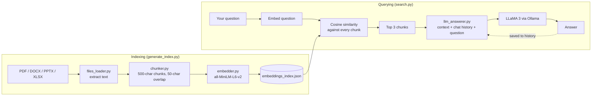

# NoteWeb

**Ask questions about your own notes and get answers grounded in them, fully offline.**

NoteWeb is a local retrieval-augmented generation (RAG) pipeline written from scratch in Python. It ingests PDFs, Word docs, slide decks, and spreadsheets, indexes them as vector embeddings, and answers questions with LLaMA 3 running locally through Ollama. Nothing leaves your machine.

I built it without LangChain or LlamaIndex on purpose: every stage (loading, chunking, embedding, retrieval, prompting) is a small module you can read in a few minutes, which makes it easy to see how RAG actually works and to swap out any piece.


---

## How it works



Indexing happens once. Each file is converted to plain text, split into overlapping chunks, and each chunk is turned into a 384-dimensional vector. At query time, your question is embedded with the same model, compared against every stored chunk, and the three closest chunks are handed to LLaMA 3 as context alongside the conversation so far.

---

## Design decisions

**No RAG framework.** Frameworks hide the parts worth understanding. Retrieval here is a cosine similarity function in NumPy and a sort, so you can see exactly why a chunk was or wasn't returned.

**Local embeddings and a local LLM.** `all-MiniLM-L6-v2` is small and fast enough to embed a semester of notes on a laptop CPU, and Ollama serves LLaMA 3 without an API key. The trade-off is answer quality versus a hosted frontier model, in exchange for privacy and zero cost.

**Fixed-size chunks with overlap.** Chunks are 500 characters with 50 characters of overlap so a sentence split across a boundary still appears whole in at least one chunk. It's simple and predictable; structure-aware chunking (by heading or paragraph) is on the roadmap.

**Flat JSON index with brute-force search.** For a personal notes folder (hundreds to a few thousand chunks), comparing against every chunk is fast and needs no database. It doesn't scale to large corpora; see Limitations.

**Conversation memory.** Previous Q&A pairs are included in the prompt, so follow-ups like "explain that more simply" work.

---

## Project structure

```
noteweb/
├── files_loader.py      # Text extraction for PDF, DOCX, PPTX, XLSX
├── chunker.py           # Fixed-size overlapping chunking
├── embedder.py          # Sentence embeddings (all-MiniLM-L6-v2)
├── generate_index.py    # Load → chunk → embed → save index
├── search.py            # Retrieval + interactive Q&A loop
├── llm_answerer.py      # Prompt construction + LLaMA 3 via Ollama
├── test_loader.py       # Tests for each pipeline stage
├── test_chunker.py
├── test_embed.py
├── test files/          # Put your documents here
└── requirements.txt
```

---

## Getting started

**Requirements:** Python 3.11+ and [Ollama](https://ollama.com).

```bash
# 1. Install Ollama and pull the model
brew install ollama
ollama pull llama3:instruct

# 2. Clone and set up
git clone https://github.com/marcanjoul/NoteWeb.git
cd NoteWeb
python3 -m venv venv
source venv/bin/activate        # Windows: venv\Scripts\activate
pip install -r requirements.txt

# 3. Add your documents to "test files/", then build the index
python generate_index.py

# 4. Start asking questions
python search.py
```

Example session:

```
🧠 Ask a question (or type 'exit' to quit): What is instruction-level parallelism?

🤖 LLaMA 3 says:
Instruction-level parallelism is when a processor executes multiple instructions
from a single program at the same time...

🧠 Ask a question (or type 'exit' to quit): how is that different from pipelining?
```

Re-run `generate_index.py` whenever you add or change files.

---

## Limitations

- **No source citations yet.** Chunks don't record which file they came from, so answers can't point back to a page.
- **Brute-force search.** Every query compares against every chunk and reloads the index from disk. Fine for a notes folder; a vector index such as FAISS would be needed for large collections.
- **Character-based chunking** can split mid-sentence or mix unrelated sections.
- **History grows unbounded** within a session, so very long conversations will eventually exceed the model's context window.
- **Text only.** Images, diagrams, and scanned (non-OCR) PDFs aren't indexed.

---

## Roadmap

- [ ] Store source file and page with each chunk and cite them in answers
- [ ] Retrieval evaluation set (question → expected chunk) to measure top-k accuracy
- [ ] Structure-aware chunking by heading and paragraph
- [ ] Skip re-embedding unchanged files
- [ ] Web UI
- [ ] TXT and Markdown support

---

## Built with

[PyMuPDF](https://pymupdf.readthedocs.io/) · [python-docx](https://python-docx.readthedocs.io/) · [python-pptx](https://python-pptx.readthedocs.io/) · [openpyxl](https://openpyxl.readthedocs.io/) · [sentence-transformers](https://www.sbert.net/) · [Ollama](https://ollama.com) · [LLaMA 3](https://ai.meta.com/llama/)

Built by [Marc Anjoul](https://github.com/marcanjoul). Feedback, issues, and PRs welcome.
